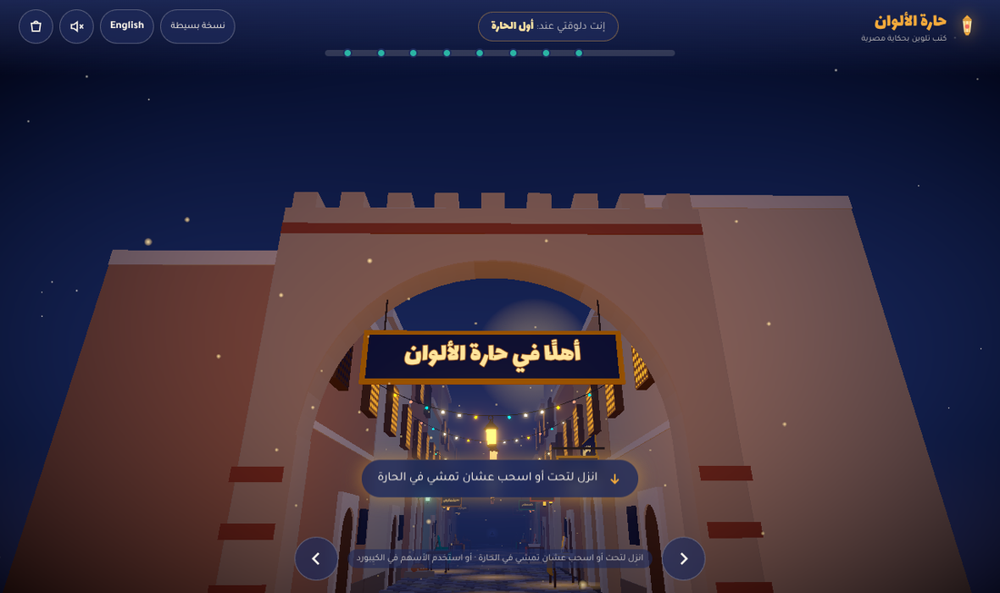
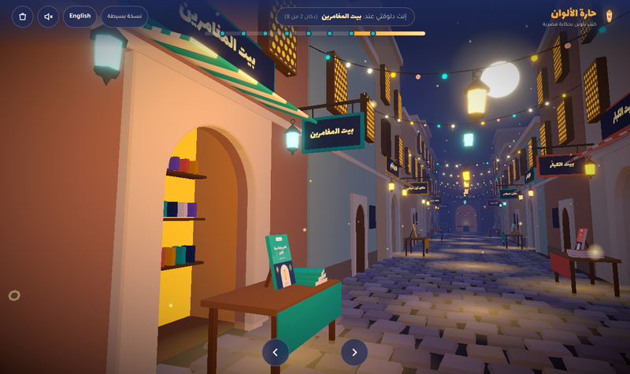
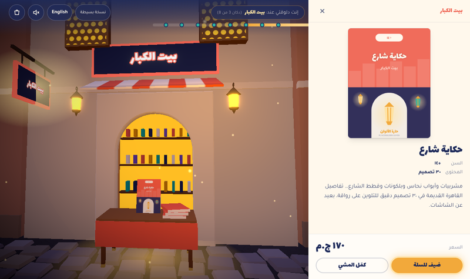
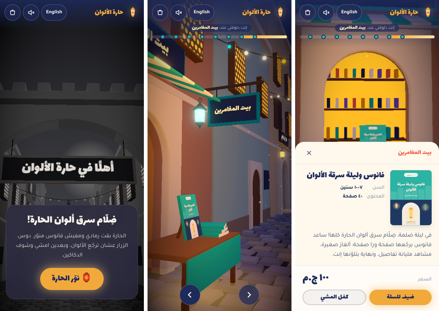

# حارة الألوان / Color Alley — 3D storefront

An immersive storefront for an Egyptian story-based colouring-book brand. The visitor walks down a stylised old-Cairo alley at night. The alley starts grey because Dhallam (ضِلّام) stole its colours. Pressing **نوّر الحارة** lights the lanterns and brings the colours back. Visitors then browse 8 shops and end at **ورشة جدو عبده**, which teases the next book.



| Walking | Shop panel | Mobile |
|---|---|---|
|  |  |  |

## Run it

```bash
cd color-alley
npm install
cp .env.example .env      # set VITE_WHATSAPP_NUMBER
npm run dev               # http://localhost:5173
npm run build && npm run preview
```

`?view=2d` or `?view=3d` in the URL forces a view, which is handy for testing.

### Deploy (Vercel)
Import the repo in Vercel and set **Root Directory = `color-alley`**. The framework is detected as Vite, and `vercel.json` sets the build command, output folder and cache headers. Add these environment variables in Vercel:

| Variable | Purpose |
|---|---|
| `VITE_WHATSAPP_NUMBER` | Number that receives orders, digits only, e.g. `2010xxxxxxxx` |
| `VITE_SIGNUP_ENDPOINT` | Optional. POST URL for the "next book" sign-up (JSON). If empty, the form opens WhatsApp instead. |
| `VITE_SITE_URL` | Public URL, used in the canonical, OG and JSON-LD tags |

## Stack
Vite + React 18 + TypeScript · React Three Fiber + drei (ScrollControls, Text, Environment/Lightformer, useCursor, useTexture, useGLTF, AdaptiveDpr, PerformanceMonitor) · @react-three/postprocessing (Bloom, HueSaturation, Vignette) · Zustand (persisted cart) · Tailwind.

## Project layout
```
src/
  data/      products.ts (catalogue, single source of truth) · i18n.ts (all AR/EN copy) · models.ts (GLTF slots)
  store/     useStore.ts (cart, language, lit state, focus, progress)
  scene/     Experience.tsx  Canvas, lights, post FX, "light up" driver
             Alley.tsx       sky, moon, stars, buildings, mashrabiyas, entrance arch
             Shop.tsx        shopfront: arch, interior glow, awning, signs, display table
             ProductDisplay  books on easels, kraft boxes, pencils/crayons (instanced)
             Lanterns.tsx    string lights, hanging fawanees, floor light pools (instanced)
             Floor.tsx       instanced cobblestones
             Workshop.tsx    ورشة جدو عبده (end of the alley)
             Cat.tsx         بسبوسة, the sleepy cat
             Dust.tsx        floating motes
             CameraRig.tsx   scroll → spline walk, head-bob, sway, focus pose
             StaticBatch.tsx merges static meshes per material (draw-call reduction)
             layout.ts / path.ts / materials.ts / shapes.ts
  ui/        Header (logo, "إنت دلوقتي عند", cart, progress) · ProductPanel · Cart · Controls (+ a11y nav)
             Landing · SignupForm/WorkshopDialog · Fallback2D · Dialog (focus trap) · audio · whatsapp
public/
  covers/<id>.png   placeholder covers → replace with real covers (same file names, 3:4)
  models/           drop GLTF/GLB files here (see below)
  fonts/            Lalezar (full TTF, OFL) for the 3D signs
  og.png
scripts/gen-assets.mjs   regenerates placeholder covers + OG image (headless Chromium)
```

## How it works
- **Walking.** drei `ScrollControls` (damped) feeds `CameraRig`. The rig samples a CatmullRom spline (`path.ts`) and adds head-bob, a gentle sway and a small pointer parallax. At each shop's stop it turns slightly to look at the shop. You can walk with the wheel or trackpad, touch scroll, a horizontal drag/swipe, the on-screen ← → buttons, or the keyboard (↑/↓ and ←/→, mirrored for RTL; Enter opens the shop in front of you).
- **Shops.** Hovering a shop makes its sign glow and changes the cursor (`useCursor`). Clicking eases the camera to face the shop. `setViewOffset` shifts the frame so the shop isn't hidden behind the RTL side panel. On mobile the panel becomes a bottom sheet.
- **Light up the alley.** `world.lit` eases from 0 to 1 and drives the HueSaturation effect (grey → colour), the bloom intensity, the emissive lantern, window and interior materials, the floor light pools, the fog colour and the light intensities.
- **Lights.** There are exactly 4 real lights: hemisphere, moon directional, a warm point light that walks with you, and one on the nearest or focused shop. Every other glow is an emissive material plus bloom.
- **Performance.** Lanterns, bulbs, light pools, cobblestones, mashrabiya windows and pencils/crayons are all instanced. `StaticBatch` merges the static scene into one mesh per material, which took the draw calls from about 850 to about 340 per frame (most of the rest is post-processing). Covers lazy-load once you're within about 24 m. `PerformanceMonitor` drops DPR, MSAA and dust density on slow devices, and `AdaptiveDpr` is on. three.js and R3F are split into chunks that are only fetched for the 3D view.
- **Fallback.** If WebGL is missing, or `prefers-reduced-motion` is set, the visitor gets a 2D scrolling page with the same shops as cards, the same cart and the same sign-up. They can switch between views from the header.
- **Accessibility.** A hidden-but-focusable nav lists every shop; it appears on Tab. Panels are real dialogs (`role="dialog"`, `aria-modal`, focus trap, Esc closes, focus is restored).
- **SEO.** At build time, `vite.config.ts` injects a real HTML product list plus `ItemList`/`Product` JSON-LD into `index.html`, both generated from `products.ts`. `index.html` also has the Arabic meta, OG and Twitter tags.
- **Cart.** The cart persists in localStorage. Checkout opens `wa.me/<VITE_WHATSAPP_NUMBER>` with the order pre-filled in Arabic or English.
- **Sound.** An ambient soundscape (drone, oud-like plucks in maqam Hijaz, crickets) is synthesised with WebAudio. It is off by default and toggled from the header. To use a recording, set `AMBIENT_URL` in `src/ui/audio.ts`.

## Swapping in real assets
- **Covers.** Replace `public/covers/<id>.png`, using a 3:4 ratio (600×800 works well).
- **Models.** Put `.glb` files in `public/models/` and set their paths in `src/data/models.ts` (`cat`, `workshop`, or per-product `products[id]`). They load with `useGLTF` and replace the procedural version.
- **Copy and prices.** Edit `src/data/products.ts` and `src/data/i18n.ts`.
