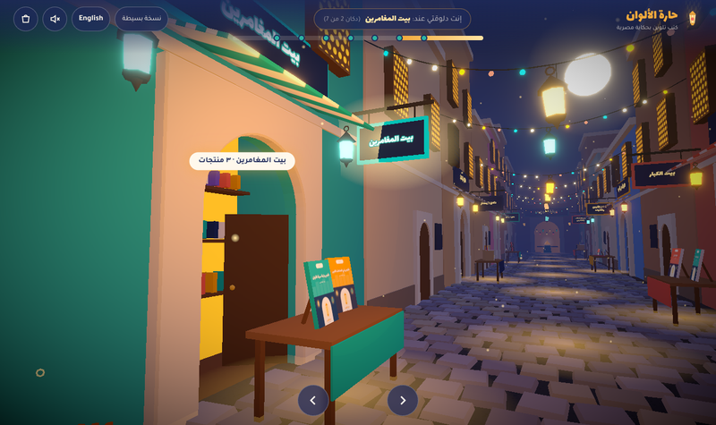
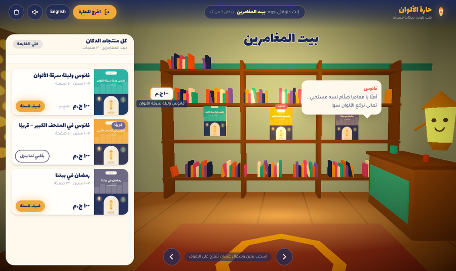
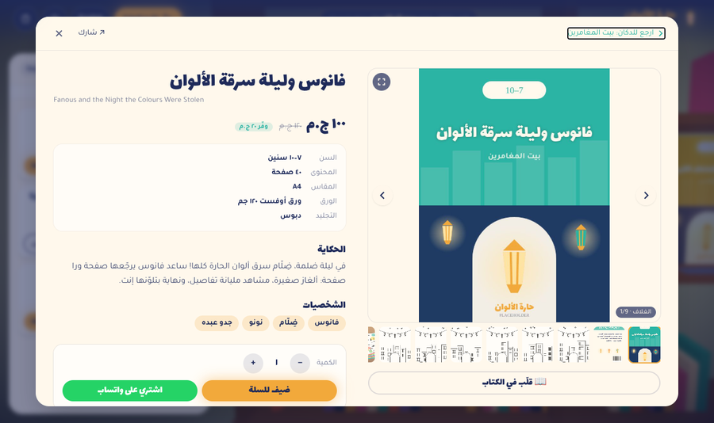
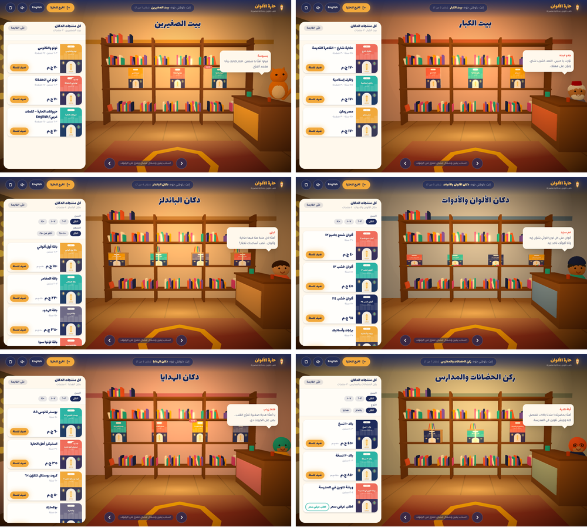
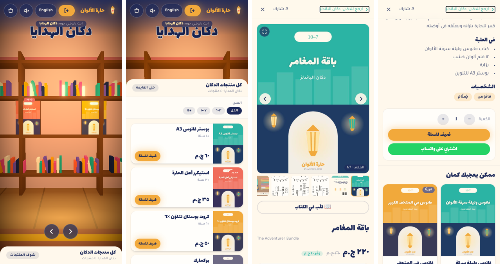

# حارة الألوان / Color Alley — 3D storefront

An immersive storefront for an Egyptian story-based colouring-book brand. The visitor walks down a stylised old-Cairo alley at night. The alley starts grey because Dhallam (ضِلّام) stole its colours. Pressing **نوّر الحارة** lights the lanterns and brings the colours back.

Each shop in the alley is a **category**. Clicking a shop walks the visitor through its door into a 3D interior, where all of that category's products sit on the shelves. Clicking a product opens a full product page with a photo gallery and a page-flip preview. At the end of the alley, **ورشة جدو عبده** teases the next book.


| Alley: hover a shop | Inside a shop | Product detail |
|---|---|---|
|  |  |  |




## Run it

```bash
cd color-alley
npm install
cp .env.example .env      # set VITE_WHATSAPP_NUMBER
npm run dev               # http://localhost:5173
npm run build && npm run preview
npm run assets            # (re)generate missing placeholder product images; -- --force for all
```

`?view=2d` or `?view=3d` in the URL forces a view, which is handy for testing.

### Deploy (Vercel)
Import the repo in Vercel and set **Root Directory = `color-alley`**. `vercel.json` sets the build, the cache headers and an SPA rewrite, so `/shop/...` and `/product/...` deep links resolve to `index.html`. Add these environment variables in Vercel:

| Variable | Purpose |
|---|---|
| `VITE_WHATSAPP_NUMBER` | Number that receives orders, digits only, e.g. `2010xxxxxxxx` |
| `VITE_SIGNUP_ENDPOINT` | Optional. POST URL for sign-ups ("next book" and "بلّغني لما ينزل"), sent as JSON. If empty, the form opens WhatsApp instead. |
| `VITE_SITE_URL` | Public URL, used in the canonical, OG and JSON-LD tags |

## Navigation (3 levels, real URLs)

| URL | Level |
|---|---|
| `/` | **Alley.** Walk the street. Hovering a shop glows its sign, opens its doors a little, and shows "‹category› · N منتج". After 300 ms of hover the interior chunk and covers start preloading. |
| `/shop/:categoryId` | **Shop interior.** Clicking a shop plays a 1 s eased walk through the door: the doors swing open, the screen fades, the alley is unmounted, and the lazy interior mounts. "اخرج للحارة" (or Back) walks you back out of the same door. |
| `/product/:productId` | **Product detail.** A full-screen RTL modal over that product's shop interior. The camera leans toward the product behind the backdrop. |

Browser Back steps out one level at a time: product → shop → alley. Deep links start directly inside. History is seeded as `/` → `/shop/x` → `/product/y`, so Back still steps out level by level. Related products *replace* the history entry, so browsing them doesn't trap the Back button. The fallback uses the same routes: on `/shop/x` it scrolls to that section, and on `/product/y` it opens the same detail modal.

## Data — `src/data/catalog.ts`
`CATEGORIES` (id, nameAr/En, wallColor, shopkeeper, order, side) and `PRODUCTS` (id, categoryId, titleAr/En, type `book|bundle|tool|gift`, ageMin/Max, price, compareAtPrice, pages, size, paper, binding, descriptions, contents, characters, images, samplePages, relatedIds, inStock, isNew, plus `quoteOnly` and `story`).

Nothing about a product is hard-coded in a component. To add a product, add an entry, then run `npm run assets` to generate its placeholder images.
- The alley layout is built from the categories' `order` and `side`. Each facade and its interior walls use the category's `wallColor`.
- Shopkeepers are placeholders built from primitives: `cat`, `fanous`, or a parametric `person` with fez, beard, scarf, cap or glasses. Each has its own greeting.
- `inStock: false` shows a "قريبًا" badge, and the product gets "بلّغني لما ينزل" (a sign-up) instead of add-to-cart. `quoteOnly` swaps the price for "اطلب عرض سعر", which opens WhatsApp.
- "ممكن يعجبك كمان" uses `relatedIds` first, then products from the same `story`, then products with overlapping ages.

**Images.** They live in `/public/products/<productId>/` as `cover.jpg`, `back.jpg`, `inside-1..n.jpg`, `contents.jpg` and `lifestyle.jpg`. The placeholders (coloured canvases with the title, and line-art colouring pages) were generated by `scripts/gen-assets.mjs`. Replace any file with a real photo of the same name.

## Project layout
```
src/
  data/      catalog.ts · i18n.ts (all AR/EN copy) · models.ts (GLTF slots)
  store/     useStore.ts (cart, language, lit state, scene/transition state, progress)
  scene/     Experience.tsx    Canvas, post FX; renders AlleyWorld OR the lazy Interior
             Alley/Shop/Lanterns/Floor/Workshop/Cat/Dust  the street (Shop = category shopfront + doors)
             CameraRig.tsx     scroll → spline walk, head-bob, walk-in / walk-out door tweens
             ProductModel.tsx  book · kraft bundle box · pencil tin · framed print (shared geometry)
             covers.ts         per-room cover texture atlas (one GPU upload)
             StaticBatch.tsx   merges static meshes per material
             htmlPortal.ts     overlay that all drei <Html> labels render into
             interior/         Interior.tsx (room, vault, instanced shelves, products, lights, pan rig) · Shopkeeper.tsx · pan.ts
  ui/        SceneDirector (route ↔ scene transitions + fade) · Header · Controls (+ a11y nav) · ShopDrawer (filters)
             ProductDetail · Gallery (swipe, lightbox zoom/pinch, FlipBook) · ProductCard · Cart · Landing
             SignupForm/WorkshopDialog · Fallback2D · Dialog (focus trap) · nav · audio · whatsapp
public/products/<id>/   product photos (placeholders)
public/models/          drop GLTF/GLB files here
scripts/gen-assets.mjs  placeholder product images + OG image (headless Chromium)
```

## Inside a shop
- **Room.** A warm room in the category's wall colour, with a barrel-vault ceiling, a glowing mashrabiya window, three swaying hanging lanterns, a rug, and a counter with the shopkeeper and a speech-bubble greeting. Tap the shopkeeper to show the greeting again. The room has 4 real lights, and the glow comes from emissive materials plus bloom.
- **Shelves.** Shelf boards and uprights share a single instanced box geometry, and the decorative book spines are another instanced mesh. Every product in the category sits at eye level and spills onto the upper shelf when there are more than 5. Hovering a product lifts it and shows a price tag; clicking opens the product detail.
- **Camera.** It pans left and right along the shelves (drag, wheel, ←/→ keys or the on-screen buttons) with a slight pointer look-around. It is not free-fly. On desktop the 3D frame shifts so the room isn't hidden behind the drawer.
- **Drawer.** The same products appear as cards (image, title, price, add-to-cart) with age, price and type filters. Filter chips only appear when they would actually narrow the list. The drawer is docked on desktop and becomes a collapsible bottom sheet on mobile.
- **Cost.** A room is about 110 draw calls and 4k triangles. The alley's heavy meshes are unmounted while you're inside.

## Product detail
- **Gallery.** A main image with thumbnails. Swipe to change image (RTL-aware), and tap or press fullscreen to open the lightbox. The lightbox supports tap/click zoom at a point, wheel zoom, pinch-zoom, drag-to-pan, swipe and the arrow keys.
- **قلّب في الكتاب.** A page-flip viewer for `samplePages`. Pages turn around the right-hand spine in Arabic and the left in English.
- **Info and buying.** Shows the title in both languages, age, pages, size, paper, binding, price with compare-at and "وفّر", contents, the story and its characters. A quantity selector sits above "ضيف للسلة" and "اشتري على واتساب" (a pre-filled message with a link to the product).
- **Extras.** Four related products, and a share button (Web Share API, falling back to copying the link). The page title updates for each level.

## Also
- **Light-up transition, instancing and fallback.** These work as before. Hovering a shop for 300 ms starts preloading its interior chunk and covers. three.js, R3F and the interior are separate chunks; the fallback page never downloads them.
- **Accessibility.** The hidden-but-focusable nav lists every shop. The drawer is a labelled region. Product, lightbox and flip-book views are real dialogs with a focus trap, Esc to close, and focus restored.
- **SEO.** At build time a crawlable HTML list grouped by shop, with links to every `/product/:id` URL, is injected into the page along with `ItemList`/`Product` JSON-LD (images, category, ages, offers). The page also has the Arabic meta, OG and Twitter tags.

## Swapping in real assets
- **Photos.** Replace files in `public/products/<id>/` using the same names. Covers are 3:4, and the lifestyle and contents photos are 4:3.
- **Models.** Put `.glb` files in `public/models/` and register them in `src/data/models.ts` (`cat`, `workshop`, or per-product `products[id]`).
- **Not done yet.** KTX2 texture compression isn't set up; the covers use a runtime canvas atlas per room. The interior shopkeepers don't have GLTF slots yet.
